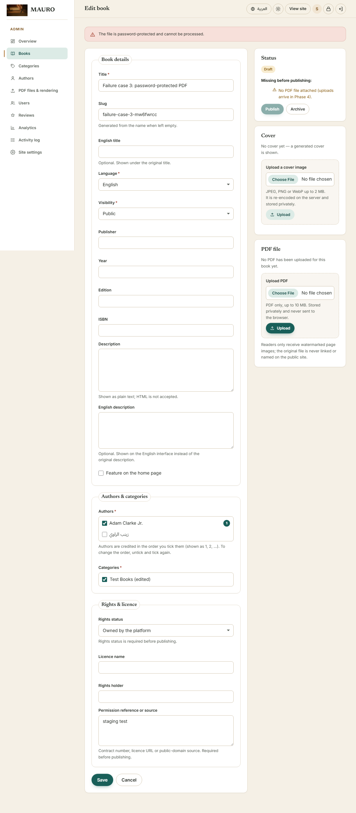
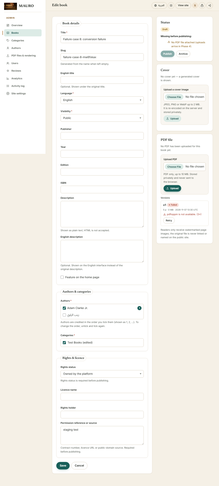
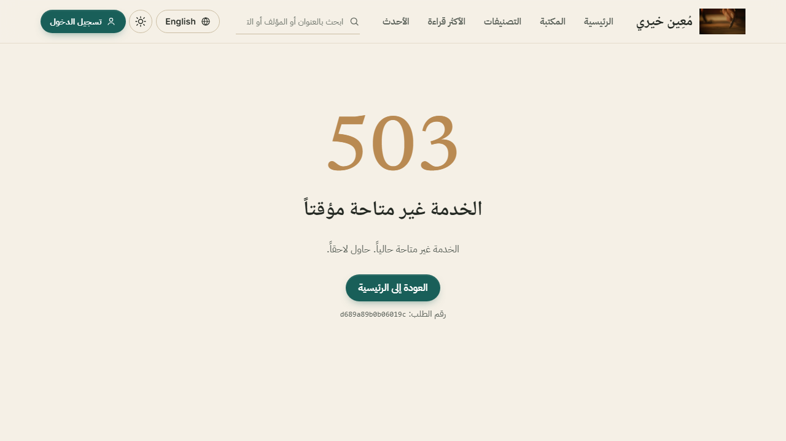
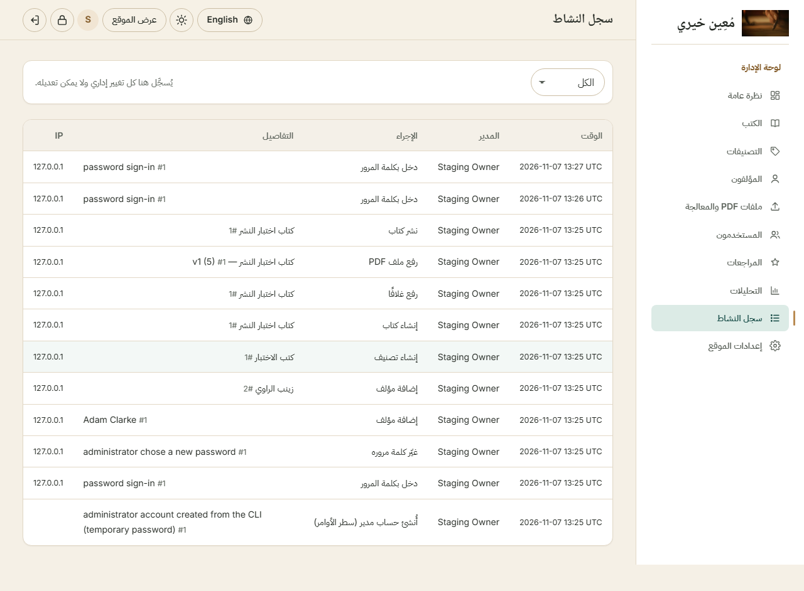

# Admin dashboard — full audit (2026-11-07)

Scope: all 14 dashboard modules, through the real browser interface, in Arabic and English, RTL and LTR, light and dark,
390 px and 1280 px. Destructive work ran only on an isolated staging copy (disposable database + private storage).
Detailed results: `ADMIN_DASHBOARD_TEST_MATRIX.md`. Publishing walkthrough: `BOOK_PUBLISHING_END_TO_END_TEST.md`.

**Verdict:** every module works; 383 browser checks passed, 0 failed. Four issues were found and fixed (below).
MySQL behaviour remains **unverified** (blocked on credentials).

## Modules

| # | Module | Status | Notes |
|---|---|---|---|
| 1 | Dashboard | ✅ | Counts come from the database (verified against SQL) |
| 2 | Book list | ✅ | Search, status filter, 20 per page, pagination |
| 3 | Create / edit | ✅ | Server-side validation, old input kept, changes persist |
| 4 | Multiple authors & order | ✅ (improved) | See fix 1 |
| 5 | Categories | ✅ | Deactivating hides the public category page immediately |
| 6 | Cover upload | ✅ | Replace, remove, re-upload; images re-encoded server-side |
| 7 | PDF upload & processing | ✅ | Validation, "Process now", cron worker, retry, version replacement |
| 8 | Publish / unpublish / archive / restore | ✅ | Publishing impossible until the current PDF is fully processed and rights are recorded |
| 9 | Users & status | ✅ | Suspension ends the member's session immediately |
| 10 | Reviews & moderation | ✅ | Hidden reviews disappear from the public page |
| 11 | Analytics | ✅ | Renders real data |
| 12 | Settings | ✅ | Persist; invalid input rejected |
| 13 | Activity log | ✅ (fixed) | See fix 2 |
| 14 | Admin authentication & authorization | ✅ | Guests → `/admin/login`; members → 403 on every route and action |

## Issues found and fixed

1. **Author order could not be chosen when creating a book** (medium, usability). The stored order was the checkbox
   order, which is alphabetical, not the order the owner ticked. Fixed with progressive enhancement: ticking an author
   moves it to the end of the ticked group and shows its rank (1, 2, …); the submitted order is the click order.
   Help text explains how to change the order. Without JavaScript the previous behaviour remains.
2. **Activity log showed raw keys for administrator sign-in events** (low, introduced by the password-login feature):
   `admin.log_admin_login` etc. had no labels. Added Arabic and English labels for all 7 new events; verified that every
   action recorded anywhere in the code has a label.
3. **No sign-out or change-password control inside the dashboard** (medium, handover). The admin top bar only showed
   the administrator's initial, so an owner had to know the `/admin/password` address and leave the dashboard to sign
   out. Added a lock icon (change password) and a sign-out button to the top bar on every admin screen, with accessible
   labels; on phones under 480 px the decorative initial is hidden so the bar never overflows.
4. **Staging test-harness issues** (no product impact) — CSRF token location, an English category label, the thumbnail
   panel being open by default on desktop, and stale staging folders after a reset — were corrected in the test scripts.

## Failure and recovery (30 / 30 passed)

| Scenario | How it was produced | Observed behaviour |
|---|---|---|
| Invalid PDF | text file named `.pdf` | "The file content is not a valid PDF (the extension alone is not trusted)." |
| Corrupted PDF | valid PDF cut in half | "The PDF could not be read; it may be damaged." |
| Password-protected PDF | qpdf AES-256 | "The file is password-protected and cannot be processed." |
| Oversized PDF | staging limit 1 MB | "The file exceeds the maximum size (1 MB)." |
| Too many pages | staging limit 5, 6-page file | "Too many pages (maximum 5)." |
| Storage full | free-space guard set above available space | "Not enough storage space on the server." |
| Database unavailable | production mode, unreachable MySQL | HTTP 503 page, no internal details (traces appear only with `APP_ENV=local` + `APP_DEBUG=true`) |
| Worker unavailable | upload without processing | stays "Queued", not publishable, not public; the cron worker later completes it |
| Conversion failure | worker run with Poppler missing | marked "Failed" with the reason and a **Retry** button; no partial images; never published |
| Thumbnail failure | thumbnail folder blocked by a file | job fails, book stays draft; after fixing storage, Retry produces all thumbnails |
| Retry after failure | Retry button | same version becomes Ready; 1 job, 10 render rows — no duplicates |
| Duplicate processing | two workers started at the same moment | exactly one claims the job |
| Double submission | double-click on Save | exactly one book created |
| Same PDF twice | upload identical file again | "This exact file was already uploaded for this book." |
| Refresh / lost connection during upload | socket closed mid-upload | nothing stored; page still usable |
| Publish before processing | button disabled + forged POST | refused; book stays draft |

In every case the book was never reported or shown as published, and rejected uploads left no temporary files.

Also observed: the admin upload limit (10 uploads per 10 minutes) triggers during automated testing — protection
working; an owner uploading books one by one will not reach it.

## Not covered / limits

- MySQL: 32 integration tests **blocked** (no valid credentials). All browser tests ran on SQLite.
- Live Google sign-in: not testable without a client ID and HTTPS domain.
- Pagination of reviews and logs was exercised only at the sizes produced by the tests.
