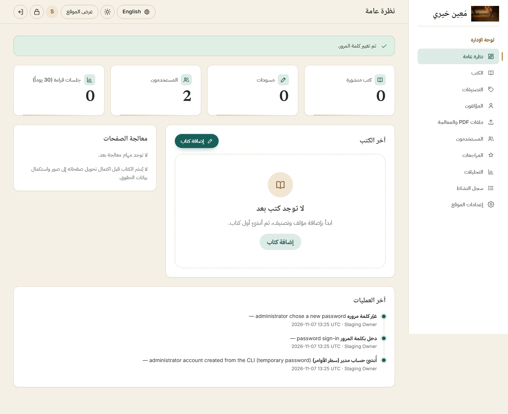
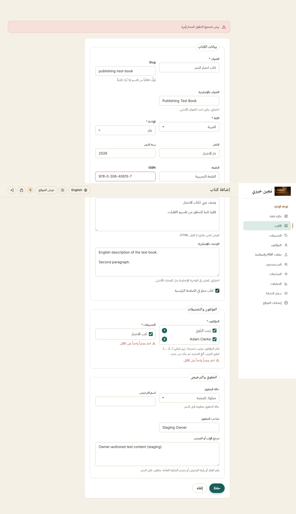
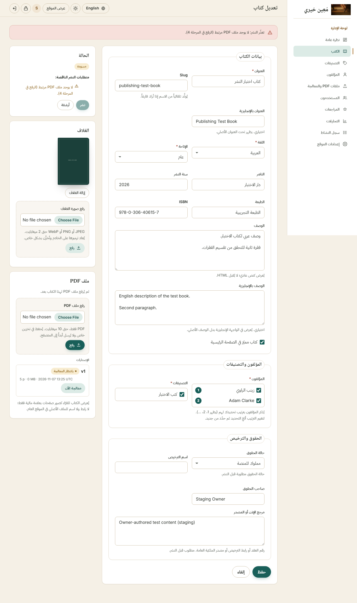
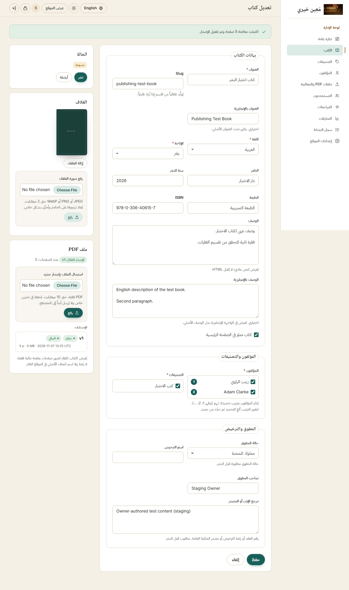
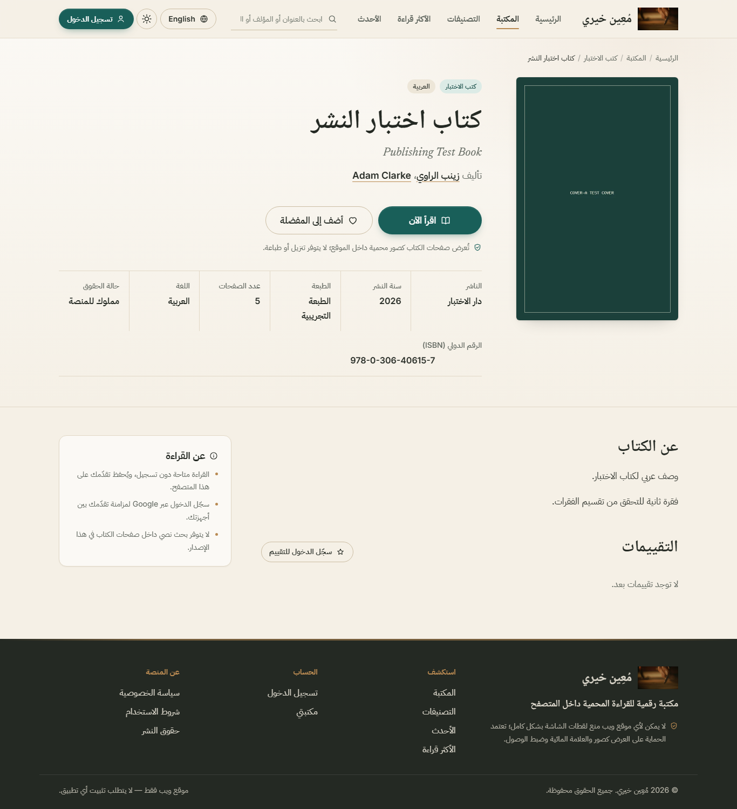
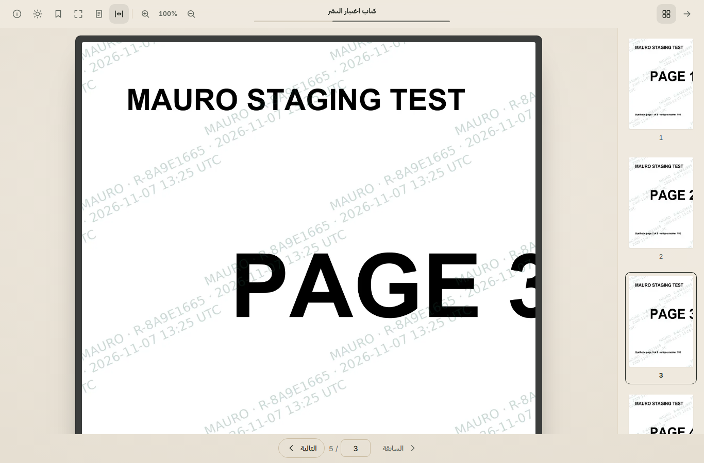

# New book publishing — end-to-end test

**Result: PASSED — 59 / 59 browser checks, 0 failed.** A website owner created, processed, published, found and read
a new book entirely through the admin dashboard and the public site, with no SQL and no code changes.

Date: 2026-11-07 · Browser: Chromium (Playwright) · Environment: isolated staging (see below).

## Environment (isolated from the real library)

| | Staging | Real library (untouched) |
|---|---|---|
| Server | `http://127.0.0.1:8003` | `http://127.0.0.1:8000` |
| Database | fresh disposable SQLite (`staging.sqlite`, created with `dev:sqlite`) | `storage/mauro.sqlite` |
| Private storage | separate folder via `STORAGE_PATH` | `storage/private` |
| Administrator | `staging.owner` (random temporary password, never printed) | `moein.khairy` |

The book was **not** inserted into the database: every step below is a click or a form in the browser.

## Test material

`test-book-5-pages.pdf` — a synthetic 5-page PDF; each page carries its own large label (`PAGE 1` … `PAGE 5`) and a
unique marker (`P01` … `P05`) so ordering can be proven. Two synthetic cover images (PNG).

## Steps and evidence

| # | Owner action | Verified | Result |
|---|---|---|---|
| 1 | Open `/admin` | redirected to `/admin/login` | ✅ |
| 2 | Sign in with the temporary password | forced to `/admin/password`; other admin pages locked | ✅ ✅ |
| 3 | Choose a private password | lands on the dashboard | ✅ |
| 4 | Add authors «زينب الراوي» and «Adam Clarke» | both listed | ✅ ✅ |
| 5 | Add category «كتب الاختبار / Test Books» | listed | ✅ |
| 6 | Submit an empty form, then a bad ISBN | clear errors; typed values kept | ✅ ✅ ✅ |
| 7 | Fill Arabic + English titles and descriptions, publisher, year, edition, ISBN, rights; tick زينب then Adam | ranks show 1 = زينب, 2 = Adam | ✅ |
| 8 | Save | draft created; Publish **disabled** with the reasons listed | ✅ ✅ |
| 9 | Upload cover | preview shown | ✅ |
| 10 | Upload the PDF | version v1, 5 pages, queued; Publish still disabled; a forged publish request is refused | ✅ ✅ ✅ |
| 11 | Click **Process now** | "Ready", 5 pages; Publish enabled | ✅ ✅ |
| 12 | Click **Publish** | published, "View on site" available | ✅ |
| 13 | Public site | found on home, catalogue, latest, category, search by Arabic title, English title and author | 7 ✅ |
| 14 | Book page | both titles, publisher, edition, ISBN, description, authors in chosen order, cover | 8 ✅ |
| 15 | Click **Read now** | reader opens, total = 5 | ✅ ✅ |
| 16 | Read pages 1 → 5 | each page displayed **and paints visible content** (pixel check after fade-in) | 10 ✅ |
| 17 | Navigation | next disabled on page 5; previous → 4; thumbnail → 2; progress restored after reload | 4 ✅ |
| 18 | Thumbnails | panel visible, 5 thumbnails loaded | ✅ ✅ |
| 19 | Reader security | only WebP images, no PDF request; signed URLs; refused from another browser session; unsigned request refused; page 6 does not exist | 5 ✅ |
| 20 | Console | no JavaScript/CSP errors | ✅ |

## Storage proof (independent of the UI)

| Check | Result |
|---|---|
| Private original | stored under `private/original-pdf/<book>/`, random name, outside `public/`; SHA-256 **identical** to the uploaded file (v1 and, after the replace test, v2) |
| Page images | 5 WebP files, 1400 × 1812, all decode |
| Thumbnails | 5 WebP files, 220 × 285, all decode |
| Ordering | each stored image was compared with an independent Poppler render of every PDF page; stored page *n* matches PDF page *n* for all 5 pages and all 5 thumbnails |
| Database | file `render_status = ready`, `page_count = 5`, 10 render rows (5 pages + 5 thumbnails) |

## Note on a finding during the run

The first runs stopped at "publish enabled after processing": the owner had not filled **Rights source**, and MAURO
correctly kept Publish disabled and listed that reason. The test then filled it as an owner would. This is the
rights safeguard working, not a defect.
